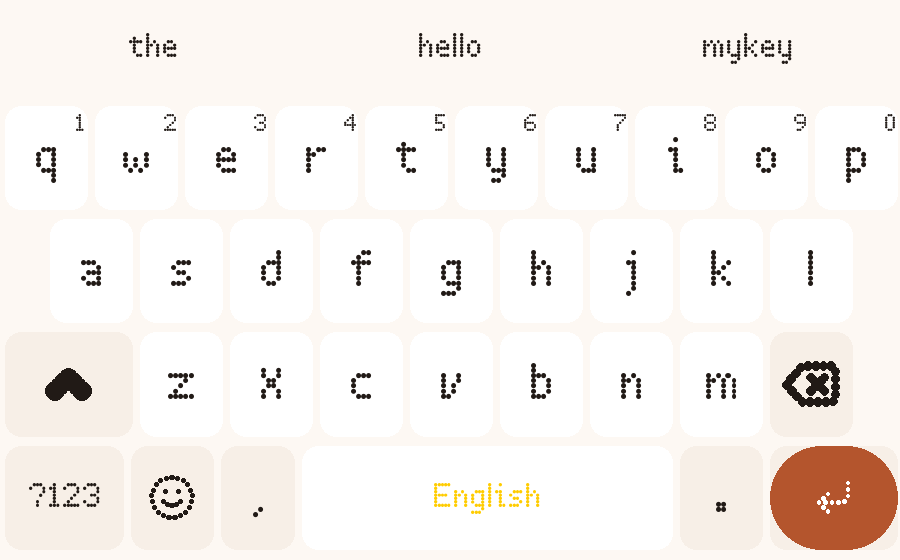
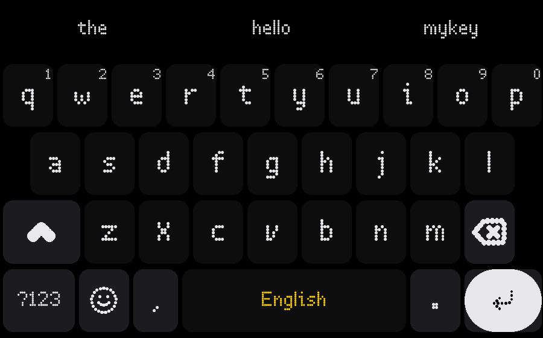

<p align="center">
  
</p>

<h1 align="center">MyKey — The Pixel Keyboard</h1>

<p align="center">
  <a href="https://github.com/explorearafat/MyKey/releases/latest"></a>
  <a href="#-download"></a>
  <a href="#-privacy"></a>
  <a href="https://github.com/explorearafat/MyKey/blob/main/LICENSE.md"></a>
</p>

<p align="center">
  
  &nbsp;
  
</p>

**MyKey** is a fast, private, fully offline Android keyboard with a pixel
design system — dotted key icons, a dot-matrix key font and 27 hand-tuned
themes. Nothing you type ever leaves your phone: the app has no internet
permission at all.

---

## ✨ Highlights

| | |
|:--|:--|
| 🎨 **27 themes** | Opens on **Warm White** (soft paper light), one tap away from **Classic Black** (graphite dark) — plus Midnight Blue, Forest, Sunset, Monochrome, Rose Quartz, Terminal and more |
| 🔤 **7 keyboard fonts** | Default is a dot-matrix pixel face; Space Grotesk, Outfit, Inter, JetBrains Mono, Doto and System complete the set |
| 🌍 **7 languages, one swipe** | English · বাংলা · हिन्दी · العربية · اردو · Español · 中文 — **swipe the spacebar** to switch language instantly |
| 🀄 **Chinese made simple** | Type pinyin, get hanzi — `nihao` + space becomes 你好, with tap-to-pick alternates (~3 KB bundled dictionary) |
| ✍️ **Glide typing** | Swipe across keys to type whole words, with a live trace path and next-word prediction |
| 📋 **Clipboard & emoji** | Built-in clipboard history and a full emoji picker, one tap from the keyboard |
| 🔒 **100% offline** | No internet permission. Suggestions, dictionaries and voice input all run on-device |
| 🎛️ **Made to fit** | Adjustable height, bottom offset, haptics, one-handed options and more |

### Language switching, the fun way

Enable your languages once — all seven ship enabled out of the box — then
**slide your thumb across the spacebar**. The keyboard switches language,
layout and dictionary instantly. No menus, no long-press popups.

<details>
<summary><b>More about Chinese (Pinyin) input</b></summary>

The Chinese keyboard is a QWERTY pinyin layout with tone marks on long-press
(ā á ǎ à, and ü on <code>v</code>). A tiny bundled dictionary maps pinyin to
hanzi: type <code>ni</code> and 你/呢/泥 appear as candidates; type
<code>nihao</code> and press space to commit 你好. Tap any candidate to pick
it — no conversion engine, no network, just a 3 KB word list.
</details>

## 📥 Download

**[⬇️ Download the latest APK](https://github.com/explorearafat/MyKey/releases/latest/download/MyKey.apk)**
— clicking starts the download immediately, always the newest release.

> Requires Android 7.0+. After installing, enable MyKey in
> *Settings → System → Keyboards* and switch your current keyboard to it.

Also available on the [Releases page](https://github.com/explorearafat/MyKey/releases)
with full changelogs.

## 🛠️ Build from source

```bash
git clone https://github.com/explorearafat/MyKey.git
cd MyKey
./gradlew assembleStableRelease
# → java/build/outputs/apk/stable/release/*.apk
```

Requirements: JDK 17, Android SDK (platform 34, build-tools 34) and Android
NDK (the keyboard engine is built from `native/jni`). The bundled
`java/shared.keystore` signs the build so it installs out of the box.

## 🔒 Privacy

- **Zero network** — the app does not hold the INTERNET permission
- Everything runs locally: suggestions, dictionaries, clipboard, voice input
- No analytics, no ads, no accounts, no tracking of any kind

## 🙌 Credits

MyKey builds on the work of many open-source projects — most notably the
Android Open Source Project's LatinIME keyboard and the
[FUTO Keyboard](https://github.com/futo-org/futo-keyboard) project. MyKey is
Apache-2.0 licensed; the full attribution list lives in
[LICENSE.md](LICENSE.md) and [NOTICE](NOTICE), and inside the app under
*Settings → About*.

## 👤 Developer

Built by **Eyasin Arafat** — themes, fonts, pixel design system, website,
everything.

| | |
|:--|:--|
| Instagram | [@explorearafat](https://instagram.com/explorearafat) |
| TikTok | [@explorearafat](https://tiktok.com/@explorearafat) |
| Facebook | [exploreeyasin](https://facebook.com/exploreeyasin) |
| WhatsApp | [+880 1610 709657](https://wa.me/8801610709657) |

## 📄 License

Licensed under the [Apache License 2.0](LICENSE.md).
